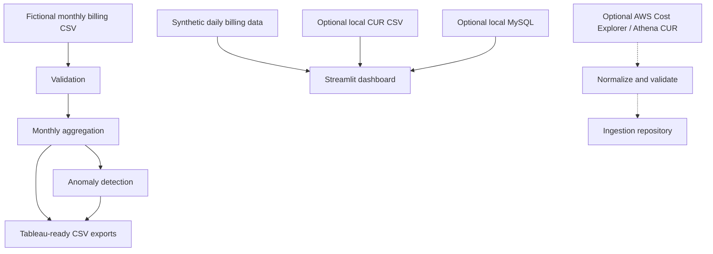

# Cloud Cost Optimization Analytics

**A Python-based FinOps analytics dashboard for exploring cloud spending, detecting cost anomalies, and identifying potential optimization opportunities.**

Cloud bills can be difficult to interpret. This project brings cost trends, service-level spending, anomaly detection, budget forecasting, and simulated optimization insights into one interactive dashboard.

Built with Python and Streamlit, it combines a synthetic billing-data pipeline, analytics components, optional local MySQL storage, and an AWS ingestion layer developed with offline testing.

> **Project status:** The dashboard uses synthetic or fictional billing data. AWS Cost Explorer and CUR/Athena ingestion have been tested offline with mocked clients, not against a live AWS account. Optimization savings and forecasts are illustrative, not measured results.

## Dashboard Preview


*Overview of synthetic cloud spending, trends, service breakdowns, and illustrative insights.*

Additional screenshots: `screenshots/cost_trends.png` and `screenshots/service_breakdown.png`.

## Key Features

- **Cost analytics:** Explore spending by service, account, region, team, environment, and time period.
- **Anomaly detection:** Identify unusual spending patterns using explainable, rule-based detection.
- **Optimization insights:** Review simulated idle or unattached resource findings and estimated monthly savings.
- **Budgets and forecasts:** Compare illustrative budgets against spending and calculate straight-line month-end projections.
- **Ask AI:** Explore billing questions using read-only SQL analysis, with validation and row limits.
- **CSV analytics pipeline:** Validate billing records, aggregate monthly service costs, flag potential anomalies, and export Tableau-ready CSV files.
- **Optional MySQL integration:** Store and query locally configured billing data.
- **AWS ingestion preparation:** Cost Explorer and CUR/Athena ingestion modules with bounded requests, configuration validation, pagination controls, scan-limit checks, and revision-aware writes.

## Technology Stack

| Area | Technologies |
|---|---|
| Language and data processing | Python, pandas |
| Dashboard and visualization | Streamlit, Plotly, streamlit-echarts |
| Database and persistence | SQLAlchemy, MySQL 8, SQLite for tests |
| SQL validation | SQLGlot |
| AWS integration | Boto3, Cost Explorer, Athena/CUR |
| Testing | pytest |
| Data visualization workflow | Tableau-compatible CSV exports |

Boto3 is optional for the ordinary synthetic-data dashboard and CSV pipeline.

## Architecture

The project contains two primary analytics workflows, plus a separate AWS ingestion layer.



The standard dashboard runs locally using synthetic data. AWS ingestion is separate, disabled by default, and does not automatically connect the dashboard to a live AWS account.

## Analytics and Methodology

### Monthly CSV pipeline

The monthly pipeline validates records, aggregates costs by service and month, and applies a documented anomaly heuristic. It compares a month's cost with the average of up to the three immediately preceding calendar months that are available.

A month is flagged when both conditions hold:

- Current cost exceeds **1.5× the baseline**.
- Current cost is at least **$100 above the baseline**.

At least one preceding month must be available. These thresholds are review rules, not a statistical accuracy claim or proof of waste.

### Dashboard analytics

The seeded daily dataset contains approximately **16,425 synthetic records** across illustrative cloud accounts, services, and regions. It includes intentionally modeled cost spikes and incomplete allocation tags for demonstrating the dashboard's analytics.

Dashboard anomaly detection uses a separate rolling baseline, with up to 28 preceding observations and a minimum of 14 observations. It flags values exceeding 2.5× the baseline and at least $10 above it.

Budget comparisons, straight-line forecasts, and optimization savings are illustrative. They do not establish actual cloud savings or predict future costs with seasonality.

## Getting Started

### Requirements

- Python 3.10 or newer
- Git
- Windows PowerShell, macOS, or Linux
- Internet access to install dependencies

No AWS credentials or MySQL server are required for the standard synthetic-data workflow.

### 1. Clone the repository

```bash
git clone https://github.com/saxenaabhinav08/cloud-cost-optimization-analytics.git
cd cloud-cost-optimization-analytics
```

### 2. Create a virtual environment

**Windows PowerShell:**

```powershell
py -3 -m venv .venv
.\.venv\Scripts\python.exe -m pip install --upgrade pip
.\.venv\Scripts\python.exe -m pip install -r requirements.txt
```

**macOS/Linux:**

```bash
python3 -m venv .venv
source .venv/bin/activate
python -m pip install --upgrade pip
python -m pip install -r requirements.txt
```

### 3. Launch the dashboard

From the project root:

**Windows PowerShell:**

```powershell
$env:PYTHONPATH = "src"
.\.venv\Scripts\python.exe -m streamlit run app.py
```

**macOS/Linux:**

```bash
export PYTHONPATH=src
python -m streamlit run app.py
```

Open the local URL printed by Streamlit, normally `http://localhost:8501`.

Choose the synthetic demo to explore the sample dashboard. Other data sources depend on their local configuration.

## CSV Pipeline and Tableau Exports

The monthly pipeline defaults to the fictional billing file in `data/raw/`.

```powershell
$env:PYTHONPATH = "src"
.\.venv\Scripts\python.exe -m cloud_cost_analytics.pipeline
```

To specify input and output paths:

```powershell
.\.venv\Scripts\python.exe -m cloud_cost_analytics.pipeline --input data/raw/fictional_aws_billing.csv --output-dir data/processed
```

The pipeline produces:

- `service_monthly_costs.csv` — monthly service-level spending.
- `spending_anomalies.csv` — flagged values, baselines, cost differences, and review notes.

These CSV files can be imported into Tableau using its Text File connector. They contain fictional data, not an export of an actual AWS account.

## Optional MySQL Integration

The project supports a separately installed, locally configured MySQL 8 database for applicable billing workflows. Database setup and credentials are not required for the default synthetic demo.

Before using this feature, review the repository's existing SQL schema, `.env.example`, and importer instructions. Keep credentials in the ignored `.env` file and never commit passwords or connection strings containing secrets.

The AWS ingestion migration is separate from the ordinary database setup and should not be applied automatically.

## AWS Ingestion: Phase 2A and Phase 2B

The optional ingestion modules prepare a controlled path for importing Cost Explorer and CUR/Athena billing data.

**Implemented and tested offline:**

- Explicit opt-in; ingestion is disabled by default.
- Validated configuration settings and bounded request, retry, pagination, and polling limits.
- Cost Explorer and Athena client abstractions.
- Canonical billing-record normalization and currency handling.
- Deterministic Athena request tokens for repeated identical query-start requests.
- Repository behavior for idempotency, revisions, transactional failures, and watermarks.
- Additive database migration checks and offline tests.

**Not yet verified:** Live AWS credentials, IAM permissions, Cost Explorer responses from a real account, an actual CUR table, live Athena execution, AWS charges, and reconciliation against the Billing console.

The Athena scan threshold is checked after execution reports its scanned bytes. It cannot prevent a query from running or guarantee a maximum query charge.

See [`docs/aws_ingestion_phase_2a.md`](docs/aws_ingestion_phase_2a.md) for the configuration reference, architecture, safeguards, and cost considerations.

## Tests

Run the test suite from the repository root:

```powershell
.\.venv\Scripts\python.exe -m pytest -q
```

The latest full offline test run during development passed **137 tests**. Tests cover the data pipeline, analytics, configuration validation, ingestion safeguards, mocked AWS behavior, and repository transaction handling.

This result is an offline test result, not evidence of a successful live AWS integration or production deployment.

## Repository Structure

```text
.
├── app.py
├── data/
│   ├── raw/
│   ├── synthetic/
│   └── processed/
├── docs/
├── screenshots/
├── scripts/
├── sql/
│   ├── schema.sql
│   ├── analytics_queries.sql
│   └── migrations/
├── src/cloud_cost_analytics/
│   ├── ingestion/aws/
│   ├── validation.py
│   ├── aggregation.py
│   ├── anomalies.py
│   ├── pipeline.py
│   ├── database.py
│   ├── mysql_import.py
│   ├── finops_analytics.py
│   └── finops_app.py
├── tests/
├── .env.example
├── .gitignore
├── pyproject.toml
├── requirements.txt
└── requirements-dev.txt
```

## Current Limitations and Future Work

- Billing records and dashboard scenarios are synthetic or fictional.
- Anomaly detection uses explainable heuristics and can produce false positives or miss patterns.
- Forecasts are straight-line estimates; optimization savings are simulated.
- AWS ingestion has offline mocked test coverage only.
- Tableau-ready CSV exports are included, but a Tableau workbook is not.
- The project is intended to run locally; no public production deployment is included.

Potential next steps include validating ingestion in a sandbox AWS account, reconciling imported totals against billing reports, adding seasonality-aware forecasting, and implementing scheduled ingestion after reviewing IAM permissions and cost controls.
