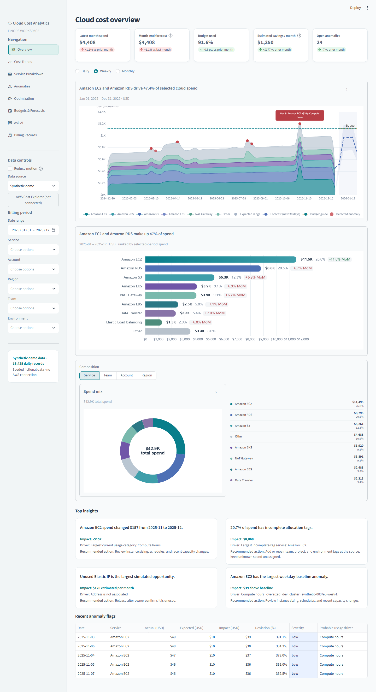

# Cloud Cost Optimization Analytics

I built this to answer the questions a cloud bill never makes easy: where is the money going, what suddenly changed, and what can be cut.

It's a Streamlit dashboard on top of a Python analytics layer, with optional MySQL storage and AWS billing ingestion code.



## What's in it

- **Cost trends and breakdowns** by service, account, region, team and environment, including how much spend is untagged
- **Anomaly detection** using a rolling 28 day baseline, with the dollar impact of each spike
- **Optimization view** that ranks idle and unattached resources by estimated monthly savings
- **Budgets and forecasts** with a month end projection per team
- **Ask AI**: ask a question in plain English and get an answer with the SQL shown. Queries are SELECT only, checked against a table/column allow list and capped at 500 rows
- **AWS ingestion layer** for Cost Explorer and CUR/Athena, with retries, request budgets, scan limits and revision safe writes

## Data

All the data in the repo is synthetic. I wrote a seeded generator that produces 16K daily records across 3 accounts, 12 services and 4 regions, with a few injected problems (a runaway NAT gateway, a cross-region backfill, an oversized dev EC2 rollout) so the detection has something real to find.

The AWS ingestion code is covered by 97 offline tests but hasn't been run against a live AWS account yet. That's the next step.

## Stack

Python, Streamlit, Plotly/ECharts, SQLite, MySQL 8, SQLAlchemy, SQLGlot, boto3 (optional), pytest

## Run it

```bash
python -m venv .venv
pip install -r requirements.txt
PYTHONPATH=src streamlit run app.py
```

Windows (PowerShell):

```powershell
py -3 -m venv .venv
.\.venv\Scripts\python.exe -m pip install -r requirements.txt
$env:PYTHONPATH = "src"
.\.venv\Scripts\python.exe -m streamlit run app.py
```

Tests: `python -m pytest`

## Design decisions

- **Decimal, not float**, for money in the ingestion layer
- **Hash based record keys** for idempotent writes, so reimporting a revised billing period doesn't double count
- **AWS calls are off by default** and tests block the network, so nothing can touch a real account by accident
- **Ask AI never gets the billing rows**, only the question and the schema

## Docs

MySQL setup, the anomaly rules, and the AWS ingestion design are in [`docs/`](docs/).

## What I'd do next

- Run the ingestion against a sandbox AWS account and reconcile totals with the Billing console
- Seasonality aware anomaly detection
- Scheduled ingestion
Installing it does not enable ingestion. The default `AWS_INGESTION_ENABLED` value is false. See [Phase 2A design and safety notes](docs/aws_ingestion_phase_2a.md) for the data flow, configuration reference, cost considerations, and future least-privilege review. No AWS credentials are requested or stored for this phase.
