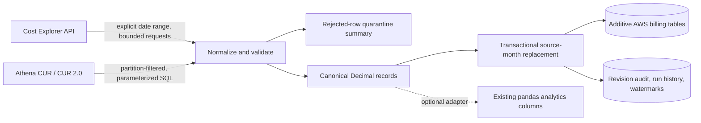

# Phase 2A: AWS cost ingestion preparation

> **NOT YET VERIFIED AGAINST REAL AWS.** This phase adds opt-in ingestion code, schema, and mocked tests only. The project has not called AWS APIs, read real billing data, created resources, or established any savings.

## Architecture and data flow



The source clients are explicit dependencies of `AwsIngestionPipeline`; nothing in app startup, imports, or the existing fictional pipeline constructs a client. Boto3 is an optional extra and is imported only after the caller explicitly enables ingestion. The default config is disabled. Tests remove AWS environment settings and block socket creation.

### Canonical record grain

Each canonical record is keyed by SHA-256 over source, linked account, usage date, service, region, usage type, line-item type, currency, cost metric, and normalized tags. Amounts stay `Decimal` through parsing, aggregation, comparison, and SQL writes (`DECIMAL(24,8)`). Cost Explorer groupings are daily aggregates, not line items. Credits and refunds with negative values are retained. Currency is taken from the Cost Explorer response unit or CUR currency column; USD is the fallback when that field is absent. Mixed-currency batches are rejected unless explicitly allowed, and the repository key keeps currencies separate. No currency conversion is performed.

The optional adapter projects canonical rows onto the current analytics DataFrame field names. It does not change the application's database reader, dashboard, or Ask AI table allowlist. To expose real-source data in the app, a later reviewed phase must explicitly integrate those surfaces.

### Restatement and idempotency

`AwsRepository.replace_scope` replaces one complete source-month within a database transaction. Reimporting unchanged rows is idempotent. Changed amounts create a revision record; rows absent from a completed replacement are recorded as deleted and removed from the current source scope. A failed transaction rolls back that month. Run status and counts are stored separately. Watermarks advance only after successful scope writes. Incremental selection includes the current month and configured recent resync window, and reselects older scopes when an observed source version changes.

## Configuration reference

All keys are optional while disabled. Environment variables take precedence over same-named Streamlit secrets. The loader reports invalid key names, never their supplied values.

| Setting | Default / purpose |
|---|---|
| `AWS_INGESTION_ENABLED` | `false`; explicit opt-in required before a client can be constructed |
| `AWS_REGION`, `AWS_PROFILE` | `us-east-1`; optional standard local profile selection |
| `AWS_COST_METRIC` | `UnblendedCost`; allowlisted cost metric |
| `AWS_MAX_LOOKBACK_MONTHS` | Default `13`; accepted range `1–13` months |
| `AWS_MAX_API_REQUESTS` | Default `100`; accepted range `1–100` API calls per client operation |
| `AWS_MAX_PAGES` | Default `100`; accepted range `1–100` pages per result/query chunk |
| `AWS_MAX_RETRY_ATTEMPTS` | Default `4`; accepted range `1–4` total attempts for a Cost Explorer request |
| `AWS_MAX_BYTES_SCANNED` | Default `5000000000`; accepted range `1–5000000000` bytes. Athena checks this after the query succeeds and before fetching result pages; it cannot stop query execution or guarantee a maximum charge. |
| `AWS_RESYNC_WINDOW_DAYS` | Default `90`; accepted range `1–366` days for the rolling source-period resync window |
| `AWS_MAX_MALFORMED_RATIO` | `0.05`; reject the batch if malformed rows exceed this fraction |
| `AWS_CUR_FORMAT` | `cur2`; `cur2` or `legacy_cur` column mapping |
| `AWS_ATHENA_DATABASE`, `AWS_ATHENA_TABLE`, `AWS_ATHENA_WORKGROUP` | Required only for Athena; strict identifier validation |
| `AWS_ATHENA_OUTPUT_LOCATION` | Required Athena results location, restricted to an S3 URI |
| `AWS_POLL_TIMEOUT_SECONDS` | Default `300`; accepted range `1–600` seconds |
| `AWS_POLL_INTERVAL_SECONDS` | Default `1`; accepted range `0–60` seconds |
| `AWS_SOURCE_AUTHORITY` | `cur`; documents the preferred source where both exist |
| `AWS_TAG_FIELD_MAP` | Optional JSON map from normalized source tag names to `team`, `environment`, or `project` |

The configured retry count applies to Cost Explorer requests only. Cost Explorer retries throttling and HTTP 5xx responses; access-denied, authentication, and other failures are not retried by the application. Athena polling has no application-level retry loop. Each Athena query start receives a deterministic `ClientRequestToken` derived from its ingestion run, source month, and query so an SDK retry can identify the same start request.

Install the optional client dependency only when preparing a sandbox environment:

```powershell
.\.venv\Scripts\python.exe -m pip install -e ".[aws]"
```

This install does not enable ingestion and does not contact AWS. Never paste credentials into chat, source control, command history, or logs. Use an approved local profile or short-lived role session outside the application. Do not put credentials in this project's `.env` for Phase 2A.

## Cost and IAM review before any future live run

This code-only phase has made **zero AWS requests**. Cost Explorer pricing and Athena scan billing depend on the account and current AWS pricing. Cost Explorer may incur per-request charges; Athena is commonly charged by data scanned, and S3 can incur storage/request charges. Review current AWS pricing and set independent account-level budgets before a later real run. The client-side request and byte caps are guardrails, not a cost estimate or billing guarantee.

For a future least-privilege review, start with read-only actions and exact resources:

- Cost Explorer: `ce:GetCostAndUsage`.
- Athena execution: `athena:StartQueryExecution`, `athena:GetQueryExecution`, `athena:GetQueryResults`, and `athena:StopQueryExecution` for the dedicated workgroup.
- Catalog reads: only the required Glue database, table, and partition metadata actions for the selected CUR table.
- CUR reads: `s3:ListBucket` constrained to the CUR prefix and `s3:GetObject` constrained to CUR objects.
- Athena result writes: `s3:PutObject` constrained to the dedicated results prefix; add only the minimum bucket-location/read permissions required by the selected workgroup configuration.

Do not grant billing configuration writes, resource-management permissions, broad account-wide S3 access, or administrator permissions. Validate the actual action/resource requirements against the selected AWS partition, workgroup, encryption settings, and current service documentation before use. No IAM policy is installed or requested by this phase.

## Offline test scope

Tests use injected fake clients and in-memory SQLite. They cover disabled-by-default behavior, request and page bounds, date limits, retry classification, query parameterization and partition predicates, scan limits, malformed rows, Decimal aggregation, redaction, idempotency, restatements, and revision audit. The suite's autouse fixture strips `AWS_*` environment variables and blocks sockets. These tests do not verify AWS service permissions, live CUR schemas, AWS account configuration, or real-world pricing.
